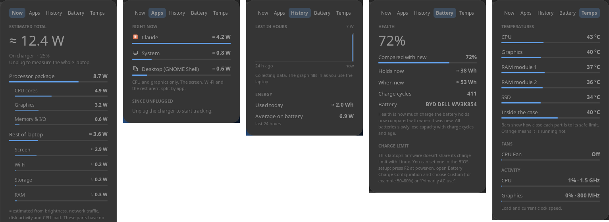

# Power Glance

A small GNOME Shell extension that shows how much power your laptop is drawing, right in the top bar. Click it for five tabs: a live breakdown by component, power by app, a 24-hour history, battery health, and temperatures with fan speeds.



No background services and no root needed for any of the tabs. It reads files in `/sys` and `/proc` and keeps a small history file in your home folder.

## The tabs

**Now.** The live breakdown: whole laptop, processor package (CPU cores, graphics, memory & I/O) and the rest of the laptop (screen, Wi-Fi, storage, RAM, other).

**Apps.** Which apps are using power right now, and which used the most since you unplugged. Each app's share of CPU time and graphics time is multiplied by the measured CPU and graphics power. The screen, Wi-Fi and the rest can't be split by app, so they aren't counted here. If the shell started while you were already on battery (after logging in, for example), the section says "On battery since login", because the real unplug time isn't known.

**History.** A bar graph of the last 24 hours in 15-minute steps (blue: measured on battery, grey: estimated on the charger), energy used today, the average draw on battery, and the energy used since you unplugged. One record per minute is kept for 7 days in `~/.local/share/power-glance/history.jsonl`. Nothing is recorded while the screen is locked or the laptop is asleep.

**Battery.** Health (capacity now compared with when new), capacity in Wh and charge cycles. If your laptop lets Linux set a charge limit, you get a "Stop charging at 80%" switch here (see [Charge limit](#charge-limit)). Otherwise the tab tells you where to set it in the BIOS.

**Temps.** Temperatures of the CPU, graphics, each RAM module, the SSD and the inside of the case, with bars showing how close each part is to its safe limit (orange when it's running hot). Fan speeds, and the CPU and graphics load and clock speed. Sensors are found automatically from `/sys/class/hwmon`, so what you see depends on your laptop. Some of these sensors are slow to read (the SSD temperature takes up to 20 ms and wakes the drive), so every reading happens in a background thread, only while this tab is open, and the slow ones are read every 6 seconds.

## What is measured and what is estimated

| Row | Source | Kind |
|---|---|---|
| Whole laptop | battery discharge rate (`/sys/class/power_supply`) | measured, on battery only |
| Processor package | AMD `gpu_metrics` table, or the `amdgpu` hwmon PPT sensor | measured |
| CPU cores, Graphics, Memory & I/O | AMD `gpu_metrics` table | measured |
| Rest of laptop | whole laptop minus processor package | measured on battery, estimated on the charger |
| Screen | backlight brightness | estimated |
| Wi-Fi | bytes sent and received | estimated |
| Storage | NVMe busy time and I/O count | estimated |
| RAM | number of memory modules and CPU load | estimated |
| Other | what is left: fan, motherboard, USB, power losses | estimated, on battery only |

Laptops have no power sensors for the screen, Wi-Fi card, SSD or RAM, so those rows (marked `≈`) come from simple models based on what each part is doing. On battery, the estimates are fitted inside the measured "Rest of laptop" figure, so the rows always add up. Expect them to be within roughly ±30–50%. They are good for spotting what uses power, not for exact numbers.

The firmware reports the processor package as a running average, while the CPU, graphics and memory parts are instant readings, so the parts are smoothed and kept within the package total.

On the charger, the battery can't report the whole-laptop figure. The top bar and the Now tab then show an estimated total (`≈`): the measured processor package plus the estimates for everything else. Without a processor sensor they show `–` instead of a total that would leave the processor out.

## Charge limit

Keeping a battery below 100% when the laptop is mostly plugged in slows its wear. Linux exposes this on many laptops as `charge_control_end_threshold`, but those files are only writable by root. To get the switch in the Battery tab, run this once:

```bash
sudo ~/.local/share/gnome-shell/extensions/power-glance@local/setup-charge-limit.sh
```

It installs a udev rule that lets your user change the charge-limit files, and nothing else. It checks first, and changes nothing if your firmware doesn't support a charge limit. Some laptops have the files but refuse to read them; on those, the Battery tab points you to the BIOS setup instead. Run it again with `--remove` to undo.

## Requirements

- GNOME Shell 46 (tested). 47 and 48 should work.
- A laptop battery, for the whole-laptop figure and the Battery tab.
- An AMD Ryzen APU for the processor rows and for watts per app. The `gpu_metrics` format 2.x covers Renoir, Rembrandt, Phoenix and Hawk Point. On other hardware the processor rows are hidden and the Apps tab shows CPU share instead of watts.

Tested on a Ryzen 5 8540U laptop running Pop!_OS 24.04.

## Install

```bash
git clone https://github.com/aadheel/power-glance.git
cd power-glance
./install.sh
```

On Wayland, log out and back in afterwards. GNOME only loads new or updated extensions at login. Then, if it isn't already on:

```bash
gnome-extensions enable power-glance@local
```

## Uninstall

```bash
gnome-extensions disable power-glance@local
sudo ~/.local/share/gnome-shell/extensions/power-glance@local/setup-charge-limit.sh --remove   # only if you ran the setup
rm -rf ~/.local/share/gnome-shell/extensions/power-glance@local
rm -rf ~/.local/share/power-glance   # the history file
```

## Its own power use

Measured on battery with the menu closed: about 0.3% of one CPU core, which works out to roughly 6–10 mW, about 0.1% of a typical 8–10 W laptop draw. Most of it is the app scan, which runs every 10 seconds on battery (every 4 seconds while the Apps tab is open) and not at all on the charger while the menu is closed. The Temps tab reads nothing unless it is open. Battery and processor readings are taken in a background thread, so the desktop never waits for the firmware. All other work is split into pieces of about 1–2 ms.

## How it's built

See [docs/ARCHITECTURE.md](docs/ARCHITECTURE.md). The data modules (`battery.js`, `history.js`, `apps.js`, `thermal.js`) have tests that run outside the shell:

```bash
gjs -m tests/test_battery.js
gjs -m tests/test_history.js
gjs -m tests/test_apps.js
gjs -m tests/test_thermal.js
```

## License

GPL-2.0-or-later. See [LICENSE](LICENSE).
