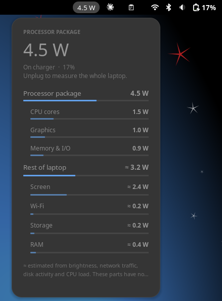

# Power Glance

A small GNOME Shell extension that shows how much power your laptop is drawing, right in the top bar. Click it for a breakdown by component.



The screenshot was taken on the charger, so the headline shows the processor package. On battery it shows the whole laptop and adds an "Other" row (fan, motherboard, USB, power losses).

No root, no daemons, no extra packages. It reads a few files in `/sys` every 2 seconds.

## What is measured and what is estimated

| Row | Source | Kind |
|---|---|---|
| Whole laptop | battery discharge rate (`/sys/class/power_supply`) | measured, on battery only |
| Processor package | AMD `gpu_metrics` table, or the `amdgpu` hwmon PPT sensor | measured |
| CPU cores, Graphics, Memory & I/O | AMD `gpu_metrics` table | measured |
| Rest of laptop | whole laptop minus processor package | measured |
| Screen | backlight brightness | estimated |
| Wi-Fi | bytes sent and received | estimated |
| Storage | NVMe busy time and I/O count | estimated |
| RAM | number of memory modules and CPU load | estimated |
| Other | what is left: fan, motherboard, USB, power losses | estimated |

Laptops have no power sensors for the screen, Wi-Fi card, SSD or RAM, so those rows (marked `≈`) come from simple models based on what each part is doing. On battery, the estimates are fitted inside the measured "Rest of laptop" figure, so the rows always add up. Expect them to be within roughly ±30–50%. They are good for spotting what uses power, not for exact numbers.

On the charger, the battery can't report the whole-laptop figure. The top bar then shows the processor package, and "Rest of laptop" becomes the sum of the estimates.

## Requirements

- GNOME Shell 46 (tested). 47 and 48 should work.
- A laptop battery, for the whole-laptop figure.
- An AMD Ryzen APU for the CPU / graphics / memory split. The `gpu_metrics` format 2.x covers Renoir, Rembrandt, Phoenix and Hawk Point. On other hardware those rows are hidden and the rest still works.

Tested on a Ryzen 5 8540U laptop running Pop!_OS 24.04.

## Install

```bash
git clone https://github.com/aadheel/power-glance.git
cd power-glance
./install.sh
```

On Wayland, log out and back in afterwards. GNOME only finds new extensions at login. Then, if it isn't already on:

```bash
gnome-extensions enable power-glance@local
```

## Uninstall

```bash
gnome-extensions disable power-glance@local
rm -rf ~/.local/share/gnome-shell/extensions/power-glance@local
```

## Its own power use

One refresh takes about 0.2 ms of CPU time, every 2 seconds. That works out to roughly 1 mW, about 0.01% of a laptop's typical draw.

## License

GPL-2.0-or-later. See [LICENSE](LICENSE).
